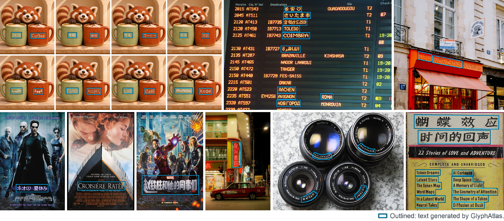
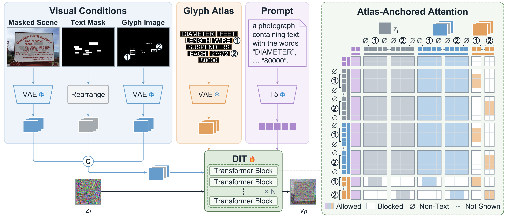

# GlyphAtlas: Disentangling Stroke Detail from Layout for Scene Text Synthesis

<p align="center">
  
  <a href="https://huggingface.co/Fr0zencr4nE/GlyphAtlas"></a>
  <a href="https://huggingface.co/datasets/Fr0zencr4nE/GlyphAtlas-Data-1.5M"></a>
  <a href="https://github.com/Fr0zenCrane/GlyphAtlas"></a>
  <a href="https://fr0zencrane.github.io/project-glyphatlas/"></a>
</p>

<p align="center">
  <a href="https://scholar.google.com/citations?user=41BWCzkAAAAJ&amp;hl=en">Luozheng Qin</a><sup>1</sup><sup>*</sup>,
  <a href="https://scholar.google.com/citations?user=mM3rnV4AAAAJ&amp;hl=en">Changhai Zhou</a><sup>2</sup><sup>*</sup>,
  <a href="https://scholar.google.com/citations?user=w3_2ep0AAAAJ&amp;hl=en">Yiyi Zhou</a><sup>1</sup><sup>#</sup>
</p>

<p align="center">* Equal contribution &emsp; # Corresponding author</p>

<p align="center"><sup>1</sup> Xiamen University, <sup>2</sup> Fudan University</p>

<p align="center">
  <a href="mailto:fr0zencrane@163.com">fr0zencrane@163.com</a>
</p>

## News

*Dates are in UTC+8.*

- **2026-11-13** — We released the [code](https://github.com/Fr0zenCrane/GlyphAtlas), [project page](https://fr0zencrane.github.io/project-glyphatlas/), and [dataset](https://huggingface.co/datasets/Fr0zencr4nE/GlyphAtlas-Data-1.5M).
- **2026-11-14** — We released the [GlyphAtlas model weights](https://huggingface.co/Fr0zencr4nE/GlyphAtlas).

## Overview

<p align="center">
  <a href="assets/figures/teaser.png"></a>
</p>

**GlyphAtlas** generates and edits scene text by separating **where text belongs** from **how its strokes are drawn**. A scene-aligned glyph image anchors layout and coarse structure, while a dedicated glyph atlas supplies detailed character and word references at an independent resolution. Together, they support small, dense and structurally complex text, multilingual editing, and joint synthesis across multiple regions.

## Method

<p align="center">
  <a href="assets/figures/framework.png"></a>
</p>

1. **Keep layout in the glyph image.** The masked scene, edit mask and scene-aligned glyph image provide appearance context, target locations and coarse glyph structure.
2. **Put stroke detail in the glyph atlas.** Characters and words are rendered in separate cells and encoded with the backbone's frozen VAE. Their reference resolution stays independent of their size in the scene.
3. **Bind both spatial streams to the atlas.** Atlas-anchored attention lets scene and glyph-image tokens retrieve the cells assigned to their regions. Atlas tokens attend to the prompt and their owning region, preserving correspondence throughout joint generation.
4. **Control detail through cell resolution.** Randomized atlas heights train the model to use different token budgets. Square cells at 48, 64 and 80 pixels contribute 9, 16 and 25 tokens, respectively.

## Quickstart

### Installation

Use Linux, Python 3.10 and CUDA 12.1. The setup script installs PyTorch 2.4.0 and the project dependencies.

```bash
git clone https://github.com/Fr0zenCrane/GlyphAtlas.git
cd GlyphAtlas
bash tools/setup_env.sh
source .venv/bin/activate
python tools/bootstrap_upstream.py
```

Enable access to [FLUX.1-Fill-dev](https://huggingface.co/black-forest-labs/FLUX.1-Fill-dev) on Hugging Face, then authenticate:

```bash
huggingface-cli login
```

### Training

[GlyphAtlas-Data-1.5M](https://huggingface.co/datasets/Fr0zencr4nE/GlyphAtlas-Data-1.5M) contains **1,535,582 scene text images across 16 sources**. The preparation script restores images and annotations; the training loader renders glyphs and masks and selects one annotation or crop view per parent.

```bash
python tools/download_assets.py --training-assets
python tools/prepare_data.py --sources all --output data/glyphatlas

bash tools/launch.sh \
  --config configs/train_glyphatlas_1p5m.json \
  --dataset data/glyphatlas \
  --output runs/glyphatlas \
  --epochs 1
```

The default recipe uses **8 GPUs**, FSDP, BF16 computation and a **global batch of 128**. One full-data epoch takes **11,996 updates**. The learning rate warms up for 500 updates to **2e-5**, then follows cosine decay to **2e-6**.

For random atlas heights, select [`configs/train_glyphatlas_1p5m_random_atlas.json`](configs/train_glyphatlas_1p5m_random_atlas.json). Source subsets use `--sources art textocr` with `configs/c4_bs128.json` and an explicit `--steps` budget. For custom annotations, use `tools/prepare_dataset.py`. See [data preparation](docs/DATA.md) and [training and resume](docs/TRAINING.md) for these workflows and multi-node launch commands.

### Inference

The released [GlyphAtlas model](https://huggingface.co/Fr0zencr4nE/GlyphAtlas) uses random atlas heights and supports `fixed48`, `fixed64` and `fixed80`. Download the weights from Hugging Face, then run the example below.

Inference runs on one BF16-capable CUDA GPU. Set the source image, scene prompt, target texts and polygons in [`examples/edit.json`](examples/edit.json). Inputs use a **512 × 512** canvas with **1–8 text regions**.

```bash
python tools/download_assets.py --inference-assets

python - <<'PY_DOWNLOAD'
from huggingface_hub import snapshot_download

snapshot_download(
    repo_id="Fr0zencr4nE/GlyphAtlas",
    local_dir="checkpoints/GlyphAtlas",
)
PY_DOWNLOAD

python runtime/infer.py \
  --input examples/edit.json \
  --checkpoint checkpoints/GlyphAtlas/transformer \
  --output runs/bookshop \
  --steps 10 --guidance 1 --atlas-mode fixed64
```

`--checkpoint` points to the downloaded `transformer/` directory. Choose `fixed48`, `fixed64` or `fixed80` to set the atlas cell height. For your own trained model, set this path to its `transformer/` export. Each result includes the edited image, glyph condition, edit mask and generation settings. JSON lists and JSONL files support batch inference; see [input formats and outputs](docs/INFERENCE.md).

## Acknowledgements

We thank the teams behind [FLUX.1-Fill-dev](https://huggingface.co/black-forest-labs/FLUX.1-Fill-dev), [FLUX-Text](https://github.com/AMAP-ML/FluxText) and [PaddleOCR](https://github.com/PaddlePaddle/PaddleOCR) for their work.

